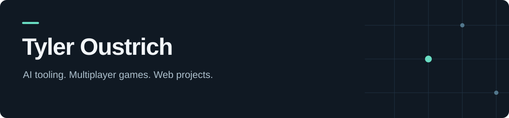

  

I build software in Python, Java, and JavaScript, from an AI usage dashboard to networked chess and a searchable D&D species guide.

[Website](https://novum-land.com) · [Try the species guide](https://ty-oustrich.github.io/dnd-tree-test/species-guide/)

## Selected projects

### [TokenWatchdog](https://github.com/Ty-Oustrich/token-watchdog)
An AI API usage proxy and dashboard that tracks tokens and estimated costs by user and project. Built as a local MVP with FastAPI, React, and SQLite, with mock requests for trying it without an API key.

`Python` `FastAPI` `React` `TypeScript` `SQLite`

### [Multiplayer chess](https://github.com/Ty-Oustrich/chess)
A Java chess application with a command-line client, a server for users and games, and a shared rules engine. Built for BYU CS 240 using HTTP, WebSockets, and database persistence.

`Java` `Maven` `HTTP` `WebSockets`

### [D&D species guide & tree test](https://github.com/Ty-Oustrich/dnd-tree-test)
A collaborative species guide with search and filters, alongside a usability-testing wireframe that records navigation and task timing for CSV export. Built with vanilla JavaScript, HTML, and CSS.

`JavaScript` `HTML` `CSS` `Usability testing`

[Open the live guide →](https://ty-oustrich.github.io/dnd-tree-test/species-guide/)

## Practice

[NeetCode submissions](https://github.com/Ty-Oustrich/neetcode-submissions) — my Python solutions to coding problems.
